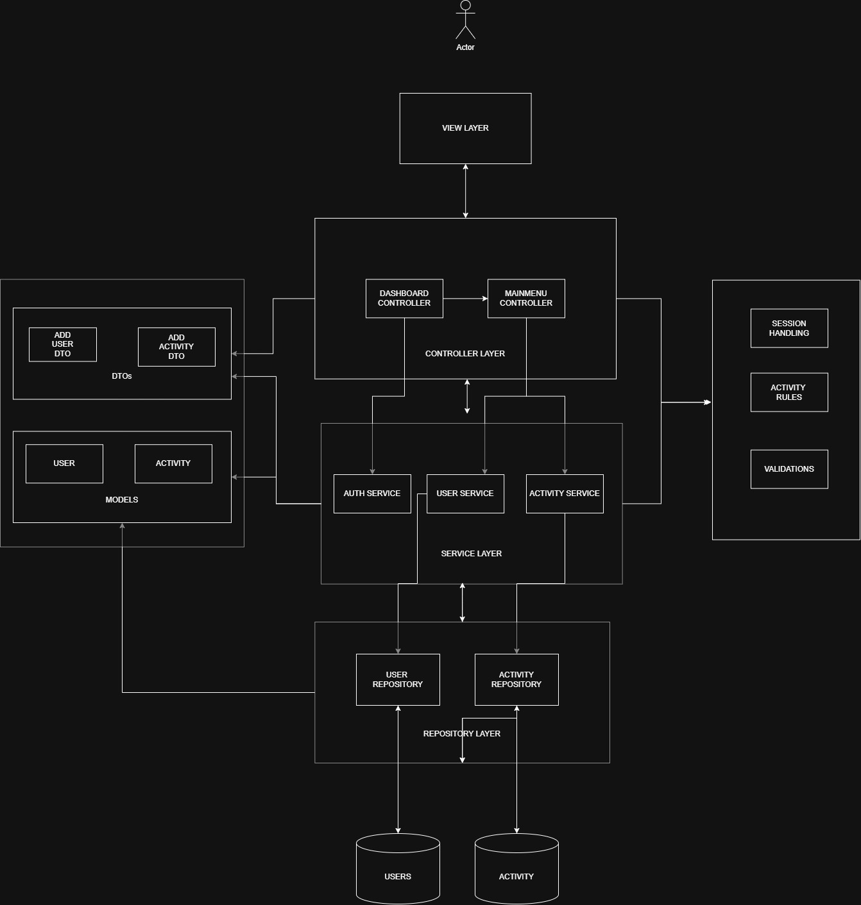
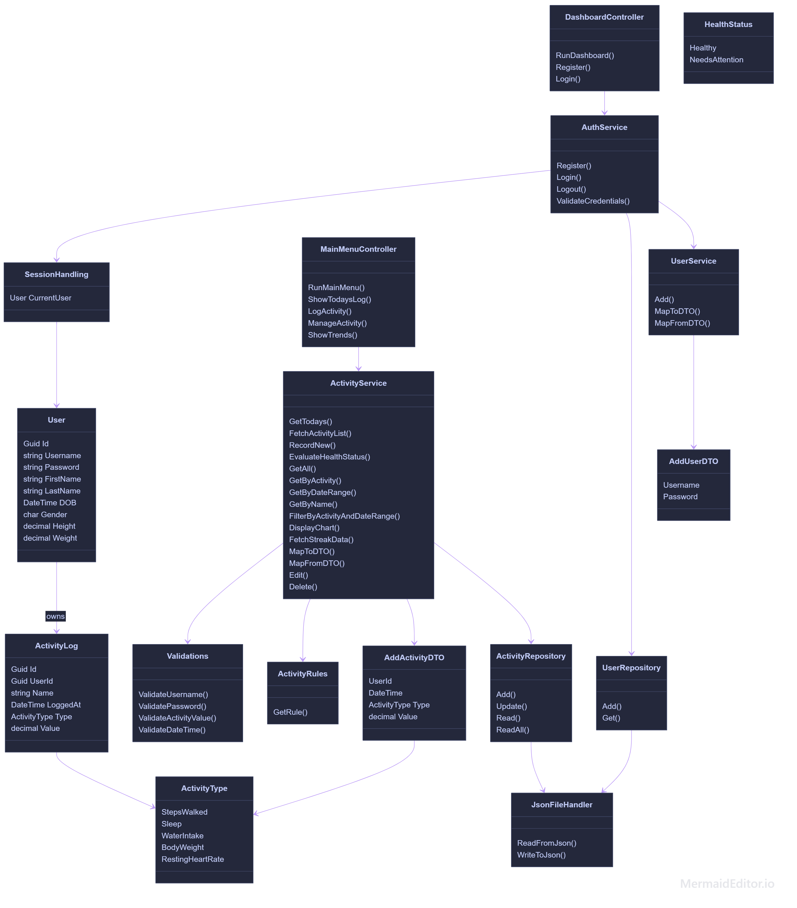
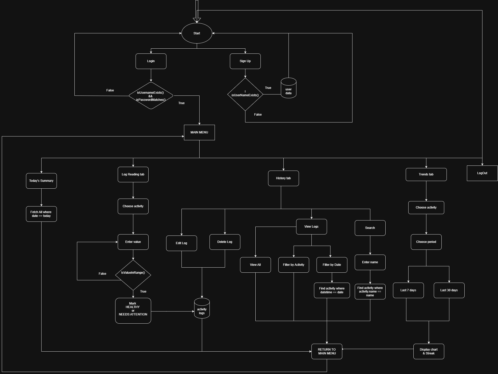
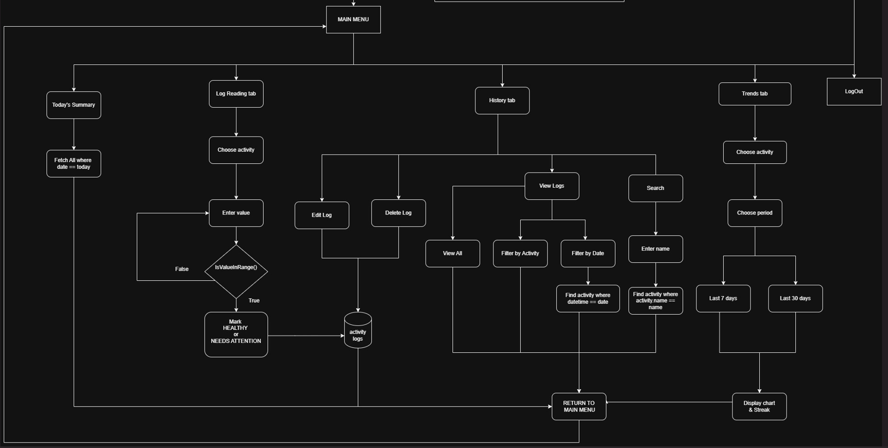
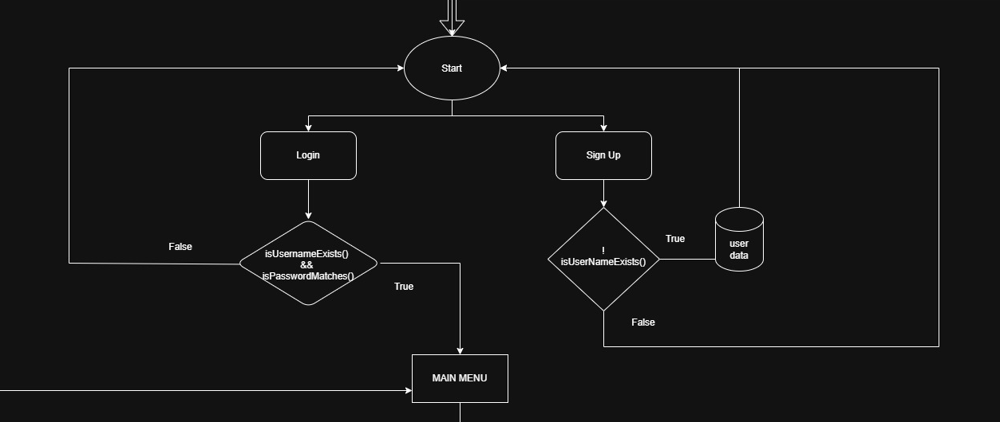
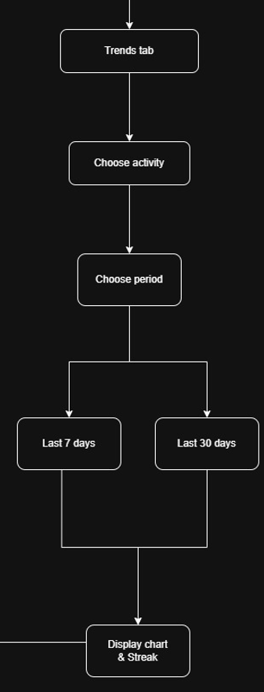
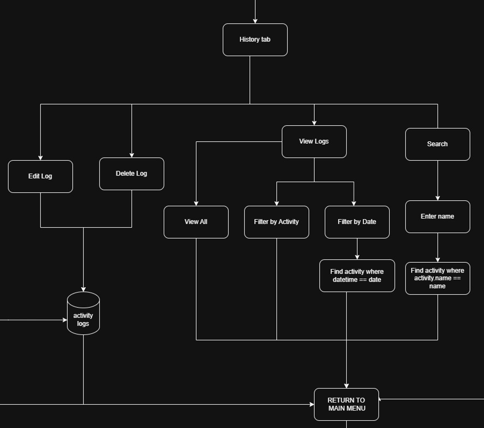
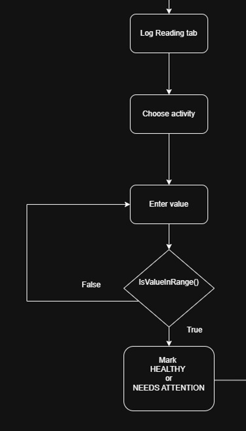

# High-Level Design (HLD)

**Project Name:** Personal Fitness and Health Tracker  
**Author:** Shubha Shree Sathish  
**Date:** 26/11/2026  
**Version:** 2.0  
**Status:** In Review

---

## 1. Problem Statement

- Problem: Need for daily tracker of healthy activities and check whether the user staying within a healthy range, that supports visualized trends.

- Stakeholders: 
    - End Users: Record daily health readings and monitor fitness progress
    - Health & Fitness Enthusiasts
- Problem with existing: 
    - User may use notebooks or spreadsheets to record their health data
    - Lack of trend based analysis
    - Users are unaware of min-max range for each activity

- Expected Outcome:
    - Functional Outcomes:
        - Record daily health values with metrics
        - Compare and show trends against defined healthy ranges
    - User Benefits:
        - Better progress tracking of individual fitness tracking
        - Convinient navigation across the application

**Problem Description:**

Individuals and fitness and health enthusiasts to track daily activities, visualize trends with comparison again healthy ranges, view, filter, search for activity logs by date and activity, along with streak update.

## 2. Goals and Objectives

- Primary Objectives:
    - To provide users with an application that enables them to record activity values and enable users to know whether their health metrics fall within the healthy ranges.
- Outcomes that define success:
    - User can successfully record and manage their daily health activity data.
    - Users can see "Healthy" or "Needs Attention" status based on their activity values along with visual trends.
    - User can filter and view their own records
- Determination parameters of solution meeting its objectives
    -  Status calculation matches with predefined health thresholds
    - Persistance of user data between user sessions
    - Accurate trend chart according to the user activity record

**Goals and Objectives:**

1. Provide platform to the users to record their daily health activities
2. Provide "Healthy" or "Needs Attention" status as per recorded value to the users
3. Show visualized trend on user's daily/weekly/monthly records 

## 3. Scope

### 3.1 In Scope

- User Registration and Authentication with session handling
- Health activity data recording status evaluation to "Healthy" or "Needs Attention".
- Today's health log display with activity wise history track
- Trend Visualization and Streak monitoring for individual activity.
- File based persistence of user data and activity records.

### 3.2 Out of Scope

- Integration with Database based storage
- Integration with mobile or desktop or web or wearable devices
- Real Time Alerts or notification

### 3.3 Assumptions and Constraints

- **Assumptions:** 
    - Password constraints:
        - At least one lowercase character (a-z). 
        - At least one uppercase (A-Z). 
        - One special character. 
        - Digit (0-9) is allowed. 
        - No Whitespace is allowed. 
        - Minimum Length: 8 characters
    - Username constraints:  
        - At least one lowercase or uppercase alphabet (a-z, A-Z). 
        - Digits (0-9) are allowed. 
        - Minimum Length: 5 characters 
        - Must be unique. 
        - Case in-sensitive 
    - Basic Profile details:  
        - First Name 
        - Last Name 
        - Date of Birth 
        - Gender 
        - Height (cm)  
        - Weight (kg)
    - Daily Activity ranges:

        | Activity | Min  | Max |
        | :---: | :---: | :---: |
        | Steps walked(steps / day) | 7000 | 10000 (caution) |
        | Sleep(hours / day) | 7 | 9 |
        | Body weight(kg) | As per BMI |  |
        | Water intake (liter) | 3 | 5 (caution) |
        | Resting heart rate (beats / min) | 60 | 100 |

- **Constraints:** 
    - The application will be implemented as C# console application and will not provide a GUI (Graphical User Interface).
    - The user interaction will be limited to text-based input and console navigation.
    - The solution's capability will be limited to .NET's runtime environmental constraints.
    - Visualization is also constrained to console.

- **Dependencies:** [List dependencies]
    - Visualization library (Scott Plot or OxyPlot) for trend visualization.
    - ANSI Console support for arrow-key menu navigation.
    - The target machine must have the required .NET runtime version installed.

## 4. Requirements

### 4.1 Functional Requirements

| ID | Requirement | Description | Priority |
|---|---|---|---|
| FR-01 | Create User Account | Users can create an account by providing their personal details  (First Name, Last Name, Username, Password, Date of Birth, Gender, Height, Weight (optional)) | Low |
| FR-02 | User Authentication | User can login and logout using user name and password | Low |
| FR-03 | Home Page | Home page shall have the following tabs: Today's Summary, Log Activity, History, Trends | High |
| FR-04 | Today's Summary tab | Activities recorded for today's date along with date time and health status | High |
| FR-05 | Log Activity Tab | User can select an activity from predefined list, record its name, datetime and the system evaluates its status | High |
| FR-06 | Individual Activity Naming | Auto-assigning of log names based on the timing | Low |
| FR-07 | Activity status evaluation | Compare user entered values with predefined healthy range and display status as "Healthy" or "Needs Attention" | High |
| FR-08 | Activity History tab - CRUD Functionality | View/edit/delete activity logs  | High |
| FR-09 | Activity History tab - Search and Filter | Search logs by datetime or activity, filter logs based on activity or date, search for an activity  | High |
| FR-10 | Highlight critical records | Highlight the record that is marked as "Needs Attention" | High |
| FR-11 | Trend Visualization | View trends for a selected activity | Low |
| FR-12 | Trend Visualization over specific time | Visualize activity trends over time (last 7 days or last 30 days), including minimum and maximum healthy threshold lines | Low |
| FR-13 | Streak Calculation and Display | Display the current streak for the selected activity | Medium |
| FR-14 | Data Persistence | Persist user information and activity logs and retrieve them when the user logs in again | High |
| FR-15 | User Validation | Validate usernames and passwords | Low |
| FR-16 | Activity specific data validation | Validate activity values and user-entered date/time information  | High |

### 4.2 Non-Functional Requirements

| ID | Attribute | Requirement / Expectation |
|---|---|---|
| NFR-01 | Usability | Navigation should be user friendly and should require minimal user training |
| NFR-02 | Performance | Health status calculation, visualisation chart generation, retrieval of historical records should occur with minimal delay |
| NFR-03 | Reliability | User data should remain available even after application restart and saved activities should not get lost |
| NFR-04 | Security | Only authenticated users shall access their activity information and user data access shall be restricted to the owner of the account |
| NFR-05 | Maintainability | New activity shall be easily configurable with minimal code changes |
| NFR-06 | Scalability | The system shall support migration to another database in future releases |
| NFR-07 | Compatibility | The application should run on systems supporting .NET environ7ment |
| NFR-08 | Data Integrity | The stored data should be prevented from any form of corruption and be accurately retrieved as it was saved |

### 4.3 Open Questions and Clarifications

| ID | Question / Uncertainty | Impact on Design | Status |
|---|---|---|---|
| Q-01 | Does the minimum and maximum values for each activity depend on gender and age? | Affects validation and healthy range calculation. | Resolved |
| Q-02 | Is the healthy weight range determined using BMI or uses common default value? | Impacts health metric calculations and user profile data. | Resolved |
| Q-03 | Does the activity list fixed or user can add manual activities too? | Affects activity management and data model design. | Resolved |
| Q-04 | How each activity entry is recorded per day (unique / total / average / latest reading ) | Affects data storage and reporting logic. | Resolved |
| Q-05 | What kind of visualization is preffered to view trends on activities? | Impacts UI design and charting requirements. | Resolved |

---

## 5. Proposed Solution

### 5.1 Solution Overview

- The proposed solution is a Personal Fitness & Health Tracker implemented as C# Console Application.
- The application enables user to register, authenticate, record their daily health activities including steps walked, sleep, water intake, body weight and resting heart beat.
- The solution follows layered architecture consisting of Controllers, Services, Repositories with Json based storage using Layered Architecture inspired by MVC principle, to ensure separability in responsibility which results in better scalability, maintainability of the system.

### 5.2 High-Level Architecture

**Architecture Diagram:**

| Component | Responsibility | Interactions |
|---|---|---|
| Dashboard Controller | Handles registration, login and dashboard navigation | Auth Service, Session Handler, View layer |
| Mainmenu Controller | Activity management, history, summary and trend analysis | Activity Service |
| Auth Service | User registration, login, logout, and authentication | User Repository, Session Handler |
| User Service | Handles user profile management and DTO mapping | User Repository |
| Activity Service | Activity recording, retrieval, filtering, health evaluation, trend generation, and streak calculation | Activity Repository |
| Session Handler | Maintains the currently logged-in user session | Auth Service, Controllers |
| User Repository | Manages user data persistence and retrieval | Json File Handler |
| Activity Repository | Manages activity log persistence and retrieval | Json File Handler |
| View Layer | Manages all the console operations | Controllers |
| Json File Handler | Reads and writes application data to JSON files | User Repository, Activity Repository |

### 5.3 Technology Stack

| Area | Choice | Version | Reason for Selection |
|---|---|---|---|
| Language / Runtime | C# with .NET | .NET 8 | Object oriented & Compactibe with console applications, Developer's Knowledge limitations |
| Data Storage | Json | N/A | Simple, easy serialization and deserialization |
| Tools / Libraries | System.Text.Json | .NET 8 | Efficient Serialization and Deserialization |
| Tools / Libraries | ScottPlot | Latest Stable version | Supports line chart generation for trend visualization |
| Tools / Libraries | Visual Studio | 2022 | Integrated Development and supports debugging for .NET solutions |

### 5.4 Module / Class Design

**Class / Module Diagram:**

| Module / Class | Layer | Responsibility | Key Operations |
|---|---|---|---|
| User | Model | Stores registered user information and profile details required for authentication and health analysis. | Manage user profile information such as username, password, date of birth, gender, height, and weight. |
| ActivityLog | Model | Represents an activity recorded by a user and captures the details required for health tracking. | Store activity name, activity type, value, timestamp, and associated user information. |
| DashboardController | Controller | Acts as the entry point to the application and manages the authentication workflow. | Run dashboard, register users, and authenticate users. |
| MainMenuController | Controller | Handles feature navigation after successful login. | Display today's summary, log activities, manage activity history, and view trends. |
| AuthService | Service | Manages authentication and user access to the application. | Register users, validate credentials, log users in, and log users out. |
| UserService | Service | Handles user-related business operations and data mapping. | Create user records and map data between DTOs and domain models. |
| ActivityService | Service | Implements business logic related to activity tracking, health evaluation, history management, and trend analysis. | Record activities, evaluate health status, retrieve activity data, filter records, generate visualizations, calculate streaks, edit activities, and delete activities. |
| UserRepository | Repository | Provides data access operations for user information. | Add and retrieve user records from storage. |
| ActivityRepository | Repository | Provides data access operations for activity logs. | Add, update, retrieve, and list activity records. |
| JsonFileHandler | Utility | Performs low-level JSON file read and write operations. | Read data from JSON files and persist updated data back to storage. |
| ActivityRules | Static Helper | Maintains predefined healthy ranges for supported activities and provides validation thresholds. | Return minimum and maximum healthy values for an activity. |
| SessionHandling | Static Helper | Maintains the currently logged-in user's session information. | Store and retrieve the active user session. |
| AddUserDTO | DTO | Transfers user registration data across application layers. | Carry username and password information during registration. |
| AddActivityDTO | DTO | Transfers activity information across application layers. | Carry activity details such as user, activity type, value, and timestamp. |
| HealthStatus | Enum | Represents the health assessment result of an activity entry. | Healthy, NeedsAttention. |
| ActivityType | Enum | Defines the supported health and fitness activities in the application. | StepsWalked, Sleep, WaterIntake, BodyWeight, RestingHeartRate. |
| Validation Components | Validation | Ensures all user inputs are valid before processing. | Validate usernames, passwords, activity values, and date/time inputs. |

### 5.5 Data Design

**Data Model / Diagram:**

**Design and Rationale:**

User Model:
- Unique Guid to identify the user. This acts as a primary key.
- Personal information details include First name, last name, Date of Birth (DOB), Gender, Height, Weight for user profile management.
- User name and password to handle authentication and sessions.
- Height and Weight to evaluate BMI for healthy weight determination

ActivityLog Model
- Unique Guid to identify the user activity.
- UserId establishes relationship with the activity record to the user.
- LoggedAt can be utilized for trend analysis and activity filtering.
- Value stores respective measurement for the activities.
- Name provides name to the activity.

DTOs:
- To show only necessary data to the controller and view layer instead of showing entire model.

### 5.6 User Interface Design

**Screen / Menu Flow Diagram:**

| Screen ID | Screen Name | Purpose | Available Actions | Navigates To |
|---|---|---|---|---|
| S-01 | Login / SignUp Dashboard | Provides a single entry point for new users to create an account and existing users to authenticate themselves. | Register, Login, Exit Application | Main Menu Dashboard |
| S-02 | Main Menu Dashboard | Serves as the central navigation hub from which users can access all application features. | View Today's Summary, Log Activity, View Activity History, View Trends, Logout | Today's Summary, Log Activity Tab, History Tab, Trends Tab |
| S-03 | Today's Summary | Displays activities recorded on the current date along with their values and health status. | View Today's Activities, Return to Main Menu, Navigate to Log Activity | Main Menu Dashboard, Log Activity Tab |
| S-04 | Log Activity Tab | Allows users to record new health and fitness activities and receive immediate health status evaluation. | Select Activity, Enter Activity Value, Enter Date/Time, Save Activity, View Health Status | Main Menu Dashboard |
| S-05 | History Tab | Allows users to view and manage previously recorded activity logs. | View All Logs, Search Logs, Filter by Activity, Filter by Date Range, Edit Log, Delete Log | Main Menu Dashboard |
| S-06 | Trends Tab | Allows users to analyze historical activity data through trend visualizations and streak information. | Select Activity, View 7-Day Trends, View 30-Day Trends, View Streak Information, Generate Chart | Main Menu Dashboard |

### 5.7 Core Workflows

**Workflow 1: Main Work Flow**

**Workflow 2: Authentication Work Flow**

**Workflow 3: Trends Tab Workflow**

**Workflow 4: History Tab Workflow**

**Workflow 5: Log Reading or Log Activity Workflow**

### 5.8 Validation and Error Handling

| Scenario | Expected Behaviour | Proposed Handling |
|---|---|---|
| Invalid username format | User should not be registered | Validate username and display validation message |
| Invalid password | User should not be registered or logged in | Validate password and display error message |
| Duplicate username | Prevent duplicate user creation | Check existing users before registration |
| Invalid activity value | Activity should not be recorded | Validate against activity rules specific to individual activities and display error |
| Invalid date/time | Activity should not be recorded | Validate date/time format and logical validity |
| Duplicate activity entry (same activity, date and time) | Prevent duplicate records | Check existing activity logs before saving |
| Incorrect login credentials | Access should be denied | Display authentication failure message |
| Missing JSON file | Application should continue to function | Create empty JSON file automatically |
| Corrupted JSON data | Application should not crash | Display error and allow recovery or file reinitialization |
| Failure while saving data | Data should not be partially persisted | Validate operation before committing changes and display failure message |
| No records found during search/filter | Application should continue normally | Display "No records found" message |

### 5.9 Security and Other Design Considerations

Security
- Only authenticated users can access application features
- Users can only view and manage their own activity records
- User session information is maintained through Session Handling.

Maintainability
- The architecture follows a layered design (Controller -> Service -> Repository -> Storage)
- Separate DTOs for controller and view layers.

Persistance
- JSON files are used for storing user and activity data
- Data remains available even if application restarts

### 5.10 Extensibility and Future Readiness

| Change Scenario | How the Design Supports It | Code Change Needed (Y/N) | Effort |
|---|---|---|---|
| Replace console UI with Web/Desktop UI | Business logic resides in Services and Repositories, thus a new UI layer to be introduced | Y | Medium |
| Replace JSON storage with database | Repository layer handles all storage logics, thus service and other layers still remains same | Y | Medium |
| Add new activity types | Extend Activity type enum and update Activity rules class | Y | Low |
| Modify activity health ranges | Update Activity Rules logic | Y | Low |
| Introduce notifications or reminders | New service can be added | Y | Medium |

---

## 6. Testing Approach

### 6.1 Testing Scope

- Functional and acceptance testing.
- Positive and negative scenario testing.
- Boundary and validation testing.

### 6.2 Test Scenarios

| Test ID | Scenario | Expected Result |
|---|---|---|
| TC-01 | Register a user with valid details | User account is created successfully |
| TC-02 | Register with an existing username | Registration is rejected with an appropriate validation message |
| TC-03 | Login with valid credentials | User is authenticated and navigated to the Main Menu Dashboard |
| TC-04 | Login with invalid credentials | Access is denied and an error message is displayed |
| TC-05 | Record a valid activity entry | Activity is saved and health status is evaluated successfully |
| TC-06 | Record an activity with an invalid value | Activity is not saved and a validation message is displayed |
| TC-07 | Record a duplicate activity for the same activity, date, and time | Activity is not saved and a duplicate record message is displayed |
| TC-08 | View Today's Summary with recorded activities | Today's activities and status are displayed correctly |
| TC-09 | View Today's Summary with no activities recorded | Informative message is displayed indicating no records exist |
| TC-10 | Search activity history by activity type | Matching activity records are displayed |
| TC-11 | Filter activity history by date range | Activity records within the selected date range are displayed |
| TC-12 | Edit an existing activity record | Updated activity information is saved successfully |
| TC-13 | Delete an existing activity record | Activity record is removed successfully |
| TC-14 | View 7-day activity trend | Trend chart is generated correctly using available data |
| TC-15 | View 30-day activity trend | Trend chart is generated correctly using available data |
| TC-16 | Logout from the application | User session is cleared and application returns to the Login Dashboard |
| TC-17 | Restart application after recording activities | Previously saved user and activity data are retrieved successfully |
| TC-18 | Missing JSON file during application startup | Application recreates the file and continues functioning |

### 6.3 Test Strategy and Acceptance Criteria

Acceptance Criteria:
- All functional requirements are satisfied
- User and activity data persist successfully across application restarts
- Invalid inputs are handled gracefully
- Application is checked throughout ensuring no where it crashes.

Defect Tracking:
- Test executing results will be tracked for each test case.
- Any defects identified during testing will be logged and rectified before handling the application to the customer.

---

## 7. Design Decisions and Trade-offs

| ID | Decision | Alternatives Considered | Selected Approach | Rationale and Trade-offs |
|---|---|---|---|---|
| D-01 | How application data will be stored | JSON Files, CSV, Database | JSON Files | JSON files are simple to implement and suitable for the expected volume of data. The trade-off is that they are not ideal for large-scale or multi-user scenarios. CSV files uses text as its data type, thus hard to parse while JSON follows Javascript's rules for parsing, thus datatype is preserved better than CSV |
| D-02 | Type of application | Console Application, Desktop Application, Web Application | Console Application | A console application meets the project requirements while keeping development simple and lightweight. The trade-off is a less interactive user experience compared to desktop or web applications. |
| D-03 | Health status evaluation approach | Manual evaluation by users, System-driven evaluation | System-driven evaluation | Automatically evaluating activity values against predefined healthy ranges provides consistent and immediate feedback. The trade-off is that healthy ranges must be maintained correctly. |
| D-04 | Supported activities | User-defined activities, Fixed activity list | Fixed activity list | A fixed list simplifies validation, reporting, and trend analysis. The trade-off is reduced flexibility for users who want to track additional activities. |
| D-05 | Data access design | Direct JSON access, Repository-based access | Repository-based access | Repositories separate business logic from storage logic, making the application easier to maintain and extend. The trade-off is a slightly more complex design. |
| D-06 | Trend visualization format | Tabular view, Bar Chart, Line Chart | Line Chart | Line charts clearly show activity patterns and trends over time. The trade-off is the need for an additional charting library. |

---

## 8. References

| Reference | Description | Link / Location |
|---|---|---|
| 1 | Microsoft's Official .NET Documentation | https://learn.microsoft.com/dotnet |
| 2 | Microsoft's Official JSON File handling documentation | https://learn.microsoft.com/dotnet/standard/serialization/system-text-json |
| 3 | Research reference for healthy water consumption level | https://www.healthline.com/health/how-much-water-should-I-drink |
| 4 | Research reference for average steps per day | https://www.healthline.com/health/average-steps-per-day |
| 5 | Research reference for the calculation of body mass index (BMI) | https://www.medicinenet.com/what_is_a_normal_bmi_range/article.htm |
| 6 | Research reference for resting heart rate | https://www.medicinenet.com/what_is_a_good_resting_heart_rate_by_age/article.htm |
| 7 | Research reference for healthy range for daily sleep | https://www.sleepfoundation.org/sleep-hygiene/what-is-healthy-sleep |
| 8 | Reference for architecture and class diagram creation | https://app.diagrams.net/ |
| 9 | Reference for architecture and class diagram creation | https://mermaid.js.org |

---
